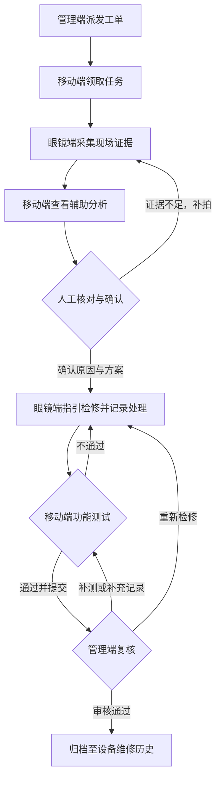
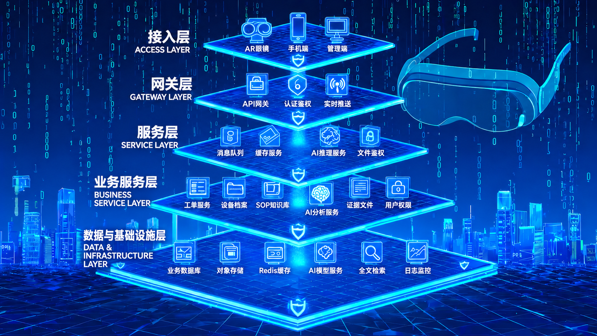

<div align="center">


# PRAXIS

### 面向设备检修的 AR 三端协同平台

**一张工单，三端协同。从现场采集，到检修闭环。**

AR 眼镜 · 移动端 · Web 管理端 · AI 辅助分析 · SOP 步骤指导

[项目宣传片](Sources/PRAXIS_智能检修宣传片.mp4) · [品牌动效](Sources/PRAXIS_Logo动效.mp4) · [业务流程](#业务流程) · [系统架构](#系统架构)

</div>

---

## 项目简介

**PRAXIS** 面向设备故障排查与现场检修，将 AR 眼镜的第一视角采集、移动端的信息核对与 Web 管理端的任务调度连接在同一张工单中，让现场操作有依据、跨端协作有衔接、检修结果可复核。

项目以 SOP（标准作业程序）组织操作步骤，以 AI 分析提供辅助建议，通过人工确认、检修记录、功能测试与管理复核形成业务闭环。PRAXIS 取“实践”之意，强调将知识转化为现场行动。

> **仓库定位**：PRAXIS 项目展示，收录品牌图标、系统架构与演示视频。本文介绍产品定位、三端协作方式及目标架构，视频中的流程用于方案表达，具体工程能力以实际交付为准。

## 项目展示

| 内容 | 查看入口 | 说明 |
| --- | --- | --- |
| 智能检修宣传片 | [观看 / 下载](Sources/PRAXIS_智能检修宣传片.mp4) | 展示任务调度、现场采集、辅助分析、检修与复核的业务路径 |
| Logo 品牌动效 | [观看 / 下载](Sources/PRAXIS_Logo动效.mp4) | PRAXIS 品牌视觉展示 |
| 系统架构 | [查看架构图](Sources/PRAXIS_系统架构.png) | 展示多端接入、业务服务与基础设施的分层设计 |
| 项目图标 | [查看 SVG](Sources/PRAXIS图标-眼镜扫描.svg) | 以眼镜与扫描元素表达项目定位 |

视频入口链接至仓库内的 MP4 文件，可打开文件页查看或下载观看。

## 场景与价值

现场检修需要同时处理设备状态、技术资料、操作记录与审核要求。PRAXIS 按终端特点分配任务，减少信息在现场与后台之间的割裂。

- **现场采集更聚焦**：眼镜端承接第一视角采集与精简步骤提示，让操作人员围绕当前任务获取信息。
- **分析依据可核对**：移动端承接原始材料、辅助建议与详细表单，由人员结合实际检查确认结论。
- **处理过程可追溯**：工单关联设备、SOP 版本、证据、处理措施和测试结果，经管理端复核后归档。

项目面向设备运维、控制柜故障排查、标准化检修与培训等场景，围绕“发现异常—确认原因—执行检修—测试复核”的路径组织协作。

## 三端协作

| 终端 | 定位 | 核心职责 |
| --- | --- | --- |
| **AR 眼镜端** | 现场采集与步骤指引 | 采集故障部位、查看当前 SOP 步骤、记录检修完成状态 |
| **移动端** | 信息核对与现场录入 | 领取任务、查看证据和辅助分析、确认故障原因、记录测量值与测试结果 |
| **Web 管理端** | 任务调度与结果复核 | 派发工单、查看设备与 SOP、核对检修证据、退回处理或审核归档 |

眼镜端以简化 HUD 聚焦当前步骤；移动端呈现详细资料与表单；管理端提供全流程信息与审核入口。

## 核心设计

### 工单驱动的业务闭环

同一张工单关联设备身份、执行人员、SOP 版本与过程记录，从派发、领取到测试、复核和归档，明确每个阶段的负责终端和进入条件。

### 辅助分析与人工确认

AI 建议进入待确认状态，由现场人员结合资料、测量值与设备实际情况确认。证据不足时返回补拍，确认原因与方案后进入检修。

### 异常分支与审核退回

功能测试不通过时返回检修；审核退回时填写原因，可选择重新检修或补充测试，避免业务流程只有单向的“完成”操作。

### 执行依据与过程留痕

设计上将工单与执行时的 SOP 版本关联，保留检查结果、原始证据、处理措施及审核记录，为设备维修历史提供追溯依据。

## 业务流程



工单包含九个阶段：**待派发 → 待领取 → 现场采集 → 辅助分析 → 人工确认 → 执行检修 → 功能测试 → 待审核 → 已归档**。

## 系统架构



目标架构包含接入层、网关层、服务层、业务服务层以及数据与基础设施层。图中“服务层”承载消息队列、缓存、AI 推理与文件鉴权等公共支撑能力；图中平台位置用于展示职责，不表示严格的调用顺序。具体组件选型与接口协议按后续工程设计确定。

| 层级 | 职责 |
| --- | --- |
| 接入层 | 为现场人员与管理人员提供适合各自任务的操作入口 |
| 网关层 | 统一 API 接入、身份校验与状态通知入口 |
| 业务服务层 | 管理领域数据、工单流转、执行依据与分析任务 |
| 公共支撑服务层 | 支撑异步处理、缓存访问、模型推理及受控文件获取 |
| 数据与基础设施层 | 保存结构化记录和原始材料，提供检索、模型运行与监控能力 |

目标数据链路：现场材料绑定工单与步骤后受控上传，分析服务结合知识资料返回建议，人员确认后执行检修；处理措施、证据与功能测试结果提交管理端复核，最终关联至设备档案。

## 仓库结构

```text
praxis-ar/
├── README.md
└── Sources/
    ├── PRAXIS_系统架构.png
    ├── PRAXIS图标-眼镜扫描.svg
    ├── PRAXIS_智能检修宣传片.mp4
    └── PRAXIS_Logo动效.mp4
```

## 后续建设

- **业务服务**：实现工单 API、设备与 SOP 管理、角色权限，完善工单状态与业务规则。
- **硬件接入**：验证目标眼镜型号及 SDK，完成真实拍照、语音交互和证据上传。
- **智能辅助**：接入识别或多模态模型与知识检索，展示建议来源并保留人工确认环节。
- **协作与追溯**：建设状态推送、异步任务、证据存储、版本管理与审核日志。
- **落地验证**：结合真实设备与检修流程，验证现场交互、分析效果及复核要求。

## 使用说明与授权

本仓库用于项目介绍与方案展示。视频及架构描述用于表达产品设计，不作为生产部署或实际维修的操作依据。

本仓库暂未提供开源许可证。展示素材的使用、修改及再分发范围，以权利人的明确授权为准。

