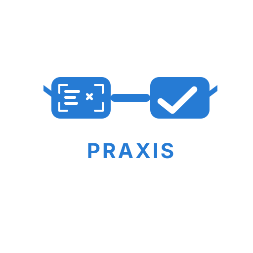
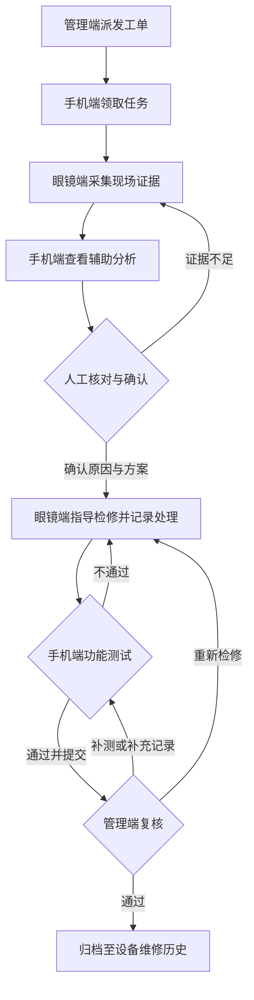

<div align="center">



# PRAXIS

### 面向设备检修的 AR 三端协同平台

**一张工单，三端协同。从现场采集，到检修闭环。**

AR 眼镜 · 移动端 · Web 管理端 · AI 辅助分析 · SOP 步骤指导

[项目宣传片](AR_SOP_智能检修宣传片.mp4) · [品牌动效](PRAXIS_Logo动效.mp4) · [快速体验](#快速体验) · [系统架构](#系统架构)

</div>

---

## 项目简介

PRAXIS 面向设备故障排查与现场检修，将 AR 眼镜的第一视角采集、手机端的信息核对与 Web 管理端的任务调度连接在同一张工单中，探索“现场信息可获取、操作步骤有依据、执行结果可复核”的检修协作方式。

项目以 SOP（标准作业程序）作为执行依据，以 AI 分析作为辅助参考，通过人工确认、检修记录、功能测试和管理复核形成业务闭环。PRAXIS 取“实践”之意，强调将知识转化为现场行动。

**当前阶段：三端 H5 交互原型与品牌展示。** 原型已实现本地模拟工单流转；真实硬件、AI 推理、后端服务与跨设备同步属于后续建设范围。本文中的系统架构为目标方案。

## 场景与价值

设备检修通常需要在现场设备、技术资料与管理系统之间反复切换。现场采集、结果判断、实际处理和审核归档如果彼此分离，就难以还原一张工单的完整处理过程。

PRAXIS 围绕三类需求组织协作：

- **现场执行**：用眼镜呈现精简步骤、采集故障部位，减少现场查看复杂界面的负担。
- **信息核对**：在手机端查看材料和分析依据，记录测量值、确认原因与测试结果。
- **过程管理**：在管理端派单、复核证据并归档，使设备、SOP 版本和检修记录保持关联。

适合设备运维、控制柜故障排查、标准化巡检与检修培训等场景的方案演示。当前样例为“风机控制柜无法启动”，设备型号、故障码与处理结论均为演示设定。

## 三端职责

| 终端 | 角色定位 | 主要交互 |
| --- | --- | --- |
| AR 眼镜端 | 现场采集与操作指引 | 查看当前步骤、模拟采集故障证据、记录检修完成状态 |
| 手机端 | 现场核对与详细录入 | 领取任务、查看证据、触发模拟分析、人工确认、填写功能测试并提交 |
| Web 管理端 | 调度、知识与复核 | 派发工单、查看设备档案与 SOP、对照检修前后证据、审核退回或归档 |

眼镜端采用简化 HUD，一屏聚焦当前任务；手机端承接长文、依据与表单；管理端承接全流程信息与审核操作。

## 核心设计

### 同一工单贯穿全过程

设备编号、执行人员、SOP 版本、采集证据、确认结论、处理措施与测试结果围绕工单关联。终端切换只改变视图，工单阶段由对应操作推进。

### AI 辅助，人员确认

分析结果先进入待确认状态。检修人员核对资料和实际检查结果，填写测量记录与故障原因后，才能进入执行阶段；证据不足时可返回补拍。当前 AI 结果使用固定演示内容。

### 检修、测试与审核闭环

完成处理后必须记录措施，测试通过后才能提交审核。测试不通过返回检修；审核退回时需填写原因，并可选择重新检修或补充测试。

### 执行依据与过程留痕

原型以固定的 SOP v1.2 展示工单执行依据，同时记录操作事件与时间。目标系统进一步保存原始材料、版本引用及审核记录，为设备维修历史提供追溯依据。

## 业务流程



对应九个工单阶段：**待派发 → 待领取 → 现场采集 → 辅助分析 → 人工确认 → 执行检修 → 功能测试 → 待审核 → 已归档**。

## 系统架构


目标架构采用分层设计。图中的“业务服务层”承载工单与领域能力，“数据与基础设施层”提供存储、模型运行与检索支撑。图中“服务层”在下表中按职责细化为“公共支撑层”；业务层调用下方数据资源，并通过公共支撑能力完成异步任务和分析处理，图中纵向位置不表示严格调用顺序。

| 层级 | 主要组成 | 责任 |
| --- | --- | --- |
| 接入层 | AR 眼镜、手机端、Web 管理端 | 提供面向不同角色的交互入口 |
| 网关层 | API 网关、认证鉴权、实时推送入口 | 统一接入、校验身份与访问权限、分发状态通知 |
| 业务服务层 | 工单、设备档案、SOP 知识库、证据管理、用户权限、AI 分析编排 | 承载业务规则、状态流转与跨端协作 |
| 公共支撑层 | 消息队列、缓存、AI 推理、文件访问鉴权 | 支撑异步任务、数据访问与受控文件获取 |
| 数据与基础设施层 | 业务数据库、对象存储、Redis、模型运行服务、全文检索、日志监控 | 存储结构化记录与现场材料，提供检索、模型运行与可观测能力 |

目标数据链路为：现场材料绑定工单与步骤，经受控上传后交由分析服务处理；分析建议与 SOP 依据返回手机端，人工确认后推进检修；处理记录与测试结果提交管理端复核，最终形成设备维修档案。

除图中明确出现的 Redis 外，数据库、消息队列、模型、检索组件及服务端框架尚未确定。实时推送与跨端同步也尚未在当前原型中实现。

## 实现状态

| 能力 | 当前状态 |
| --- | --- |
| 三端界面、协作总览与终端切换 | 已实现 H5 原型 |
| 九阶段工单流转与阶段操作校验 | 已实现本地状态逻辑 |
| 补拍、测试失败、审核退回及归档 | 已实现模拟分支 |
| 必填记录校验、操作时间线、本地保存与重置 | 已实现 |
| 设备台账、SOP 知识库、检修档案 | 演示页面与固定数据 |
| 现场照片、AI 识别、眼镜连接状态 | 模拟内容 |
| 真实拍照上传、语音交互与眼镜 SDK | 待接入 |
| 服务端 API、数据库、认证与权限控制 | 待建设 |
| 多用户实时协同、消息推送、检索与监控 | 目标架构规划 |

当前技术栈为 **HTML5 + CSS3 + 原生 JavaScript + localStorage**，无 npm 安装和构建步骤。原型中的三个终端共享同一页面内的演示状态，不代表三台设备之间已经建立连接；不同浏览器窗口之间也不提供实时同步。

## 快速体验

### 运行环境

使用支持 JavaScript 和 localStorage 的现代浏览器。通过本地 HTTP 服务预览时，另需安装 Python 3。

### 打开原型

原型目录：`C:\Users\22293\Desktop\AR检修三端H5原型-20261101`。

直接使用浏览器打开该目录中的 `index.html`，或在 PowerShell 执行：

```powershell
Set-Location -LiteralPath 'C:\Users\22293\Desktop\AR检修三端H5原型-20261101'
python -m http.server 5190 --bind 127.0.0.1
```

随后访问 <http://127.0.0.1:5190>。结束预览时在终端按 `Ctrl+C`。

### 建议演示路线

1. 打开“三端协作图”，了解终端分工。
2. 在管理端派发工单，在手机端领取任务。
3. 切换眼镜端完成模拟采集，再在手机端查看模拟分析。
4. 填写检查结果与人工确认结论；可先体验“证据不足，补拍”。
5. 在眼镜端记录处理措施，在手机端填写功能测试结果。
6. 提交管理端审核，体验通过归档或退回处理。
7. 查看工单动态与检修档案；点击“重新演示”可清除当前浏览器内的模拟记录。

演示记录保存在当前浏览器的本地存储中。原型尚未部署为互联网服务，眼镜 HUD 与 Rokid 连接信息仅用于交互表达，具体型号适配仍需验证。页面内个别旧名称沿用早期稿件，项目统一名称为 **PRAXIS**。

## 文件说明

原型目录：

```text
AR检修三端H5原型-20261101/
├── index.html       # 页面入口与终端导航
├── styles.css       # 三端布局与视觉样式
├── app.js           # 界面渲染、表单交互与本地状态保存
├── flow.js          # 工单阶段与状态转换规则
├── equipment.svg    # 演示设备示意图
└── README.md        # 原型使用说明
```

本展示目录中的相关素材：

| 文件 | 用途 |
| --- | --- |
| `PRAXIS图标-眼镜扫描.svg` | 项目图标 |
| `PRAXIS_系统架构.png` | 目标系统架构概念图 |
| `AR_SOP_智能检修宣传片.mp4` | 项目宣传片，文件名保留早期名称 |
| `PRAXIS_Logo动效.mp4` | 品牌 Logo 动效 |
| `subtitles.srt` | 宣传片业务流程字幕 |

视频链接适合本地下载或打开观看；Markdown 阅读器是否支持内嵌播放取决于使用的平台。

## 后续建设路线

- **业务服务落地**：实现工单 API、设备与 SOP 数据管理、人员角色和权限校验，将本地模拟状态迁移至服务端。
- **真实现场采集**：验证目标眼镜 SDK、拍照与语音能力，完成证据上传及工单步骤绑定。
- **辅助分析接入**：连接识别或多模态模型与知识检索，为建议提供可查看的来源，并保留人工确认节点。
- **多端协作与追溯**：建设状态推送、异步任务、原始证据存储、审核日志及服务监控。

以上为建设方向，不构成已交付能力或性能承诺。

## 使用与授权

本材料用于项目展示与原型评审。演示故障码、SOP、设备参数和测试结果不应直接用于实际检修。现场作业需遵循适用设备资料和正式作业规程。

当前材料未附开源许可证；代码、图标与视频的使用及再分发范围，以项目权利人的明确授权为准。

## 文档参考

本文按项目定位、功能、架构、运行方法与使用边界组织，结构参考 [GitHub README 文档规范](https://docs.github.com/en/repositories/managing-your-repositorys-settings-and-features/customizing-your-repository/about-readmes) 与 [Google README 写作指南](https://google.github.io/styleguide/docguide/READMEs.html)。项目事实依据三端 H5 原型、所提供的系统架构图及宣传字幕整理。

